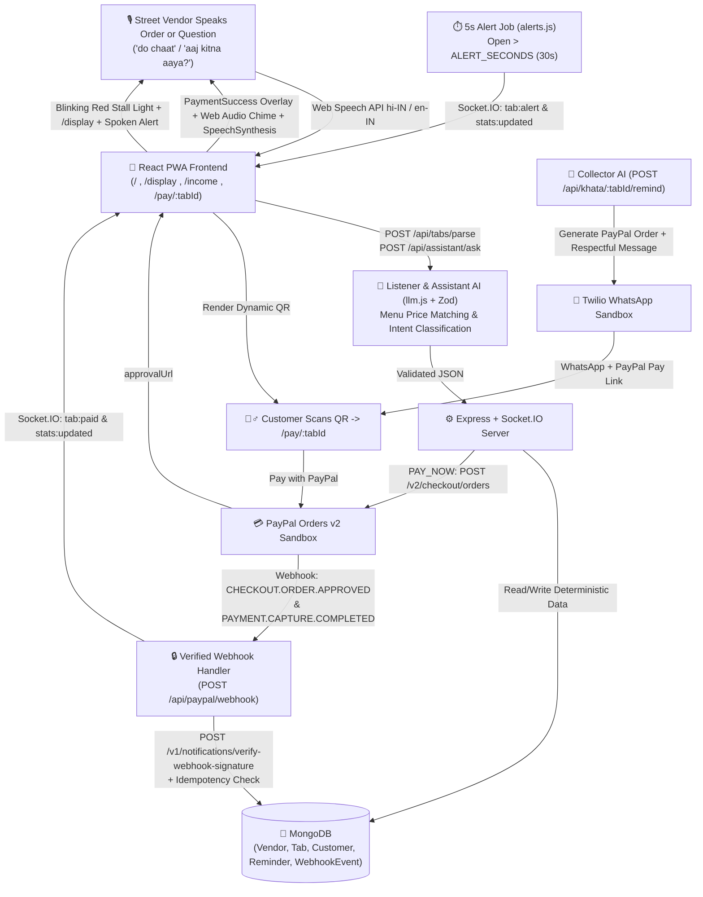

# Bharosa (भरोसा) — Voice-First Payment & Credit-Recovery Assistant for Street Vendors

> **Built for the PayPal AI Hackathon**
> *Every spoken order becomes an open tab with a live countdown ring until a verified PayPal webhook confirms payment — stopping walk-offs in crowded stalls, answering the vendor's spoken questions, and recovering informal credit (khata) with polite WhatsApp PayPal links.*

---

## 1. The Problem

Informal vendors in busy markets (street-food stalls, tea stalls, fruit carts, food trucks) lose 10–15% of daily earnings to two leaks:

1. **Crowded Walk-Offs:** During peak rush, a soundbox shouts *"₹40 received"*, but not **who** paid or **which order** it settled. Some customers show fake payment screenshots or quietly walk away while the vendor's hands are busy serving.
2. **Awkward Credit (*Khata*):** Vendors give credit to daily regulars ("Raju, 2 chai, khata") on memory or paper scraps and lack a polite, friction-free way to follow up with a direct payment link.
3. **Zero Time for Typing:** Vendors cannot type into calculators or navigate small menus in bright sunlight with wet or oily hands.

---

## 2. The Solution: Bharosa

**Bharosa** ("trust" in Hindi) lets the vendor **only serve and listen**:

- **Sunlight-First One-Handed UI:** High-contrast daylight palette (`#FFFFFF` cards, `#14181F` ink, semantic green/amber/red/blue tokens), 56px+ touch targets, and a fixed bottom thumb dock with a giant **Speak Order** mic button, **Add by tap** (`MenuTiles`), **Khata**, and **Ask Stall** assistant mic.
- **Speak the Order (Live Listening Overlay & Confirmation Card):** Tapping **Speak** opens a full-screen `ListeningOverlay` with a pulsing mic, animated 7-bar sound wave, and live interim transcript. When speech finishes, `ConfirmationCard` displays item chips with `+/-` counters, total, Pay Now / Khata mode toggle, spoken confirmation prompt (*"2 chaat, 80 rupees. Confirm?"*), and optional spoken *"haan" / "yes"* confirmation.
- **"The Usual" for Regulars:** Saying *"Raju ka roz wala"* or *"Raju's usual"* deterministically resolves the customer's most frequent item combination from their last 10 orders in MongoDB (tie-broken by most recent) and displays a **⭐ Raju's usual** badge on the confirmation card.
- **Smart Credit Limit:** Computes an explainable credit limit for each regular customer from their repayment rate, average days to repay, and largest settled tab (e.g., *"Raju usually pays in about 1 day (83% settled). Safe up to ₹300"*) with **Accept / Edit** controls and a soft warning when a new khata order exceeds the limit.
- **Two-Way WhatsApp Collector Agent:** Reads customers' inbound WhatsApp replies (`"Friday ko de dunga"`, `"abhi 100 de raha hoon baaki kal"`, `"mera nahi tha ye order"`, `"band karo"`), records payment promises (`Promise` model), generates partial-payment PayPal links without touching balances until the verified webhook arrives, flags disputes/unclear replies in a **"Needs You"** list, pauses reminders until the promised date, and follows up automatically if overdue.
- **Adaptive Alert Timing:** Learns time-of-day payment thresholds (`p50` and `p90` across 6 buckets: `07–11`, `11–15`, `15–18`, `18–21`, `21–24`, `00–07`) from historical `PAY_NOW` PayPal orders (`alertSeconds = clamp(round(p90 * 1.2), 20, 120)` when `samples >= 15`), snapshotting `alertAfterSeconds` onto each tab so the server alert job and `CountdownRing` stay in sync.
- **Recovered by Bharosa & Close-Day Summary:** Tracks money recovered from orders paid *after* an unpaid alert (`GET /api/stats/recovered?days=7`) on both the home screen and `/income`, and provides a one-tap **Close-Day Summary** (`GET /api/day/summary`) with spoken Hindi/English readout.
- **Desktop Two-Column Layout, Swipe Gestures & Sunlight Mode:** Adapts to a 2-column dashboard on screens `>900px` (left = tab list, right = Today strip, Recovered card & live activity feed), supports touch swipe right = **Cash** and swipe left = **Cancel** (with 5-second **Undo** toast), and includes a high-contrast **Sunlight Mode** toggle in the `☰` menu.
- **Dynamic PayPal Orders v2 QR & Customer Receipt (`/pay/:tabId`):** Creates a **PayPal Sandbox Order** (`POST /v2/checkout/orders`) linked via `purchase_units[0].custom_id = tabId`. Customers scanning the QR see an itemised bill on `/pay/:tabId`, pay with one tap via PayPal, and receive a **"Confirmed by PayPal"** digital receipt.
- **Webhook-Only Truth + Item-First Voice Announcements:** Only a verified **PayPal Webhook** (`POST /v1/notifications/verify-webhook-signature` + `PAYMENT.CAPTURE.COMPLETED`) transitions a tab to **PAID**. While cards retain `#number` visually, the Voice Agent speaks the **actual items and amount** (*"2 Chaat, 1 Chai, 100 rupees received"* / *"2 Chaat, 1 Chai के 100 रुपये मिल गए"*) on order creation, payment confirmation, and walk-off alerts so the vendor immediately knows **whose** order was paid without looking at the screen.
- **📸 AI Vision Menu Card Scanner (`MenuScannerModal.jsx`):** Vendors or college cafeterias can scan/upload any physical menu card photo (via **Gemini 2.5 Flash Vision** or 1-click presets for *🏫 College Cafeteria*, *🍲 Chaat & Chai Stall*, and *🍹 Juice & Shake Corner*), edit item prices, and lock the menu (`PUT /api/vendor/menu`) so the Voice AI and quick-order chips immediately learn the new items and fixed prices.
- **🛡️ Anti-Fraud Fake Payment Screenshot Shield (`POST /api/vendor/verify-receipt`):** Stops the #1 street-stall scam (spoofed/edited payment screenshots or reused old screenshots). Cross-checks customer screenshots against the live **MongoDB PayPal Webhook Ledger** + Gemini Vision forensics, flagging fake or replay-attack receipts (`Risk: 96/100`) with an immediate spoken fraud alert.
- **💙 PayPal Working Capital & Micro-Loan Readiness Score (`/income`):** Computes a live **Bharosa Trust Score (`300–900`)**, tier (`GOLD / SILVER / STARTER`), and pre-qualified **PayPal Working Capital** advance in `INR` from 3 verified pillars: *PayPal Digital Ratio*, *AI Khata Recovery Rate*, and *7-Day Sales Consistency*, complete with an interactive **1-Click Instant Disbursal** drawer (`0%` collateral, `4%` fixed fee, `8%` daily PayPal sales auto-repayment).
- **🎬 Live Side-by-Side Customer Phone Simulator & Split-Bill (`👥 Split ÷2`) Checkout (`JudgeSimulatorPanel.jsx`):** Dockable smartphone preview allowing judges to test two-way **WhatsApp AI Credit Collection** and **PayPal Checkout** (including 1-click full payment and **`👥 Split ÷2`** partial group payments for cafeteria friends) on a single screen.
- **🏆 Interactive 90-Second Judge Pitch Tour & 1-Click Reset (`POST /api/dev/pitch-reset`):** Top ribbon with **`🎬 Reset Pitch State`** and 5 guided steps (`1️⃣ Scan Menu` → `2️⃣ Voice Order` → `3️⃣ Fake Receipt Shield` → `4️⃣ WhatsApp AI + Split ÷2` → `5️⃣ PayPal Micro-Loan`).
- **Smart `INR` (`₹`) Currency + PayPal Live FX Fallback (`paypal.js`):** Operates natively in `INR` (`₹`) across the UI, voice agent, and database while automatically converting `INR` → `USD` (`1 USD = ₹84`) at the PayPal Sandbox API boundary if an international sandbox account returns `422 CURRENCY_NOT_SUPPORTED`.
- **30-Second Countdown Ring & Blinking Red Stall Light:** Every open tab shows a live SVG `CountdownRing` draining over `ALERT_SECONDS` (default 30s). If unpaid at 0s, the top **Stall Light** banner (and the crowd-facing `/display` screen) blinks red (`🚨 N unpaid`) and speaks an item-specific alert aloud.
- **Ask Your Stall by Voice ("Stall Assistant"):** The vendor taps the **Ask Stall (`🤖`)** mic button and asks *"aaj kitna aaya?"*, *"how much is pending?"*, or *"kaun kaun udhaar mein hai?"*. The AI classifies the intent, computes the exact numbers deterministically from MongoDB (never inventing numbers), and speaks the answer aloud.
- **Shareable Verified Income Statement (`/income`):** Displays a 7-day SVG bar chart and KPI breakdown separating **PayPal-confirmed (verified)** earnings from **vendor-recorded cash**, with a print stylesheet and a shareable read-only link (`/income?token=<shareToken>`).

---

## 3. Application Routes & Screens

| Route | Purpose |
| :--- | :--- |
| **`/`** | **Vendor Home Screen:** Sticky Stall Light banner, live Today Strip (*Collected, Pending, Khata*), sorted Tab cards with `CountdownRing` & `StatusChip`, `MenuTiles` tap fallback, and fixed Bottom Dock. |
| **`/pay/:tabId`** | **Customer Payment & Receipt Page:** Mobile bill shown after scanning the QR code with a giant **Pay with PayPal** button and post-payment **"Confirmed by PayPal"** receipt. |
| **`/display`** | **Crowd-Facing Stall Display Mode:** Full-screen green (*"All paid ✓ / सब भुगतान हो गया"*) or blinking red (*"Payment pending / भुगतान बाकी"*) status screen with Wake Lock and zero customer personal data. |
| **`/income`** | **Vendor Income Statement:** 7-day SVG bar chart, PayPal-verified vs. vendor-recorded cash split, Print/Download button, and shareable public link (`/income/public/:token`). |

---

## 4. Architecture Diagram



---

## 5. Setup & Running Locally

```bash
# 1. Copy environment variables
cp .env.example .env

# 2. Install backend and frontend dependencies
npm run install:all

# 3. Build the React PWA frontend
npm run build

# 4. Start the unified server (serves API + Socket.IO + built PWA on http://localhost:4000)
npm start
```

### Running Tests & Walk-Off Simulation

```bash
# Run unit & integration tests (Zod parser, webhook idempotency, currency mismatch, and 6 Stall Assistant intents)
npm test

# Run the 50-order Walk-Off & Payment Simulation script (writes simulation-results.json)
npm run simulate
```

---

## 6. 60–90 Second Demo Script

1. **Voice Order + Big QR + Green Payment Chime (0:00 – 0:25):**
   - Open `http://localhost:4000`. The top **Stall Light** is green (`सब भुगतान हो गया ✓`) and the **Today Strip** shows live *Collected, Pending, Khata* totals.
   - Tap the centre green **Speak (`🎙️`)** button (or toggle `🧪 Demo` and tap `"do chaat"`).
   - Order #1 (`2× Chaat — ₹80`) and the high-contrast **QR modal** appear.
   - Scan/open `/pay/<tabId>` and click **Pay with PayPal** -> the customer screen shows a **Confirmed by PayPal** receipt, while the vendor screen flashes the full-screen green **PaymentSuccess** check, plays a chime, and speaks: *"Order 1 paid."*
2. **Countdown Ring & Crowd-Facing Red Stall Light (0:25 – 0:55):**
   - Create a second order and close the QR modal. Watch the circular **`CountdownRing`** drain over 30 seconds.
   - When it hits `0s`, the top **Stall Light** and `/display` crowd screen blink bright red (`🚨 1 भुगतान बाकी`) with a spoken alert.
3. **Ask Your Stall by Voice (0:55 – 1:10):**
   - Tap the **`🤖 Ask Stall`** mic button (or the `"aaj kitna aaya?"` demo chip).
   - Bharosa computes the exact figures from MongoDB and replies aloud: *"आज 3 ऑर्डर से कुल ₹170 आए हैं (₹130 PayPal और ₹40 कैश)।"*
4. **Khata WhatsApp Reminder & Verified Income Statement (1:10 – 1:30):**
   - Switch to **Khata (`📓`)** and tap **Remind Now** on Raju to send a polite WhatsApp reminder with a PayPal link.
   - Open **`/income`** from the header menu (`☰`) to show the 7-day SVG bar chart splitting **PayPal-confirmed (Verified)** earnings from **vendor-recorded cash**, complete with a one-click Print button and shareable link.

---

## 7. Simulation Results (`scripts/simulate.js`)

| Metric | Baseline Walk-Off Sim | Fixed 30s (Rush Mix) | Adaptive Timing (`p90 × 1.2`) |
| :--- | :--- | :--- | :--- |
| **Total Tabs Simulated** | `50` | `50` | `50` |
| **Walk-Offs Detected** | `8 / 8 (100%)` | `8 / 8 (100%)` | `8 / 8 (100%)` |
| **Median Alert Latency** | `32s` | `32s` | `35s` (Morning `22s` / Evening `46s`) |
| **False Alerts (Paid Later)** | `0` | `13` (during evening rush) | `0` |

> **Honest Evaluation Note:** In the Fixed 30s vs. Adaptive comparison, payment delays are synthetically generated by time-of-day bucket (faster in morning `14–19s`, slower in evening rush `27–38s`). Because the simulator generates hour-dependent payment delays, this comparison is a **simulation of the algorithm's mechanics**, not real-world field accuracy. See `simulation-results.json` (`"note"` field).

---

## 8. Twilio WhatsApp Sandbox Setup & Guardrails

1. In the **Twilio Console → Messaging → Try it out → Send a WhatsApp message (Sandbox Settings)**, set **"When a message comes in"** (`POST`) to:
   - Production: `https://<your-render-url>/api/whatsapp/inbound`
   - Local testing with ngrok: `https://<your-ngrok-id>.ngrok-free.app/api/whatsapp/inbound`
2. Any test phone acting as the customer (e.g. your own phone) must first join the Twilio WhatsApp Sandbox by sending the join code (`join <two-words>`) to the sandbox number.
3. For local demos without a live phone, when `DEV_MODE=true`, you can trigger inbound customer replies via `POST /api/dev/whatsapp-inbound` (`{ "phone": "+919876543210", "text": "Friday ko de dunga" }`) or use the one-tap **Simulate WhatsApp reply** chips in the **Khata** tab.
4. **Safety & Send Limits (Enforced in Code):**
   - **Never modifies money:** A customer reply saying *"I paid"* is treated as a claim (`NEEDS_VENDOR`), never a payment. Only verified PayPal webhooks or explicit vendor Cash confirmation change balances.
   - **Hard guardrails:** Outbound messages are checked against `validateCollectorReplyGuardrails` (blocking threats, shaming, police/legal mentions, discounts/waivers, or unauthorized amounts) and fall back to deterministic templates.
   - **Rate limits & Quiet hours:** Max `2` outbound messages/day and `4`/week per customer (`MAX_REMINDERS=4`), `whatsappConsent=true` required, and messages between **21:00 and 08:00 IST** are queued for morning.

---

## 9. Honest Limitations & Roadmap

- **Noisy Market Audio:** Street markets are loud; Bharosa mitigates recognition errors with confidence thresholds and the large `MenuTiles` one-tap fallback.
- **Customer Scan-to-Pay Familiarity:** Adoption depends on customers scanning dynamic QR codes.
- **Payment Rail Context:** India predominantly uses UPI; PayPal Sandbox (`Orders v2` + Webhooks) serves as the programmable payment and verification rail for this hackathon.
- **Customer Consent:** Automated WhatsApp reminders strictly require `whatsappConsent = true`.
- **Roadmap:** Offline IndexedDB queue for patchy market connectivity, and direct micro-loan underwriting integrations using the `/income` verified statement token.
